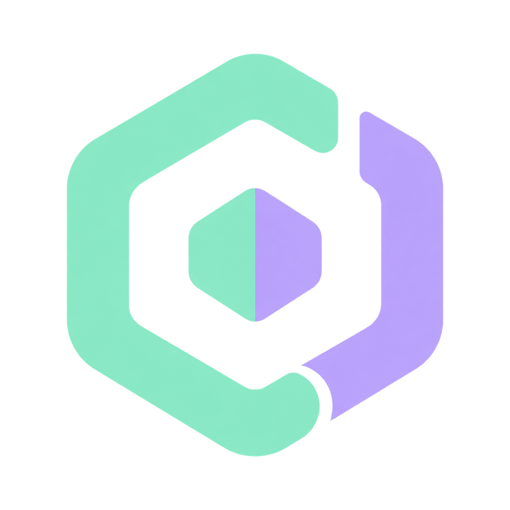

<p align="center"></p>

# Agent Dock

Agent Dock is a small standalone Windows usage widget. It displays local system telemetry and the freshness, remaining usage, reset, and weekly-window information its read-only collectors can observe. It does not connect Claude to Codex, route work, run prompts, delegate tasks, or act as an agent.

The widget-only edition is **v0.2.0**. It does not automatically remove integrations from an older installation. Existing private integrations remain yours to manage separately.

Windows-first, no hosted backend, no API key, and no project/workspace setup. MIT licensed. Not affiliated with Anthropic, OpenAI, or Microsoft.

## What it shows

- Remaining short-term and weekly usage when a collector can read it, plus reset time/countdown and the age of each observation.
- CPU, RAM, fixed disks, and observable local CLI/session processes.
- A compact edge dock, expandable Bulgarian WPF panel, notification-area icon, show/hide controls, and refresh/error state.
- Unknown rather than invented data: missing, stale (over five minutes), invalid, or future-dated usage is shown as unknown. Reset expiry never creates a new quota reading.

Usage normally refreshes every 60 seconds; system metrics every 5 seconds and processes every 15 seconds. These are display intervals, not guarantees of provider availability. Percentages mean remaining usage.

## Platform support and limitations

The WPF UI is Bulgarian. Windows 10 desktop behavior is supported only for builds **17763–19045**; build 19045 is the locally validated baseline. On those builds, the widget can follow virtual desktops and focus an unambiguous existing console session without moving it. Windows 11 and other Windows builds may show the widget but do not have supported complete cross-desktop integration. macOS and Linux are unsupported.

Codex usage is read from the native Codex CLI app-server. Its polling is read-only and makes no inference. Claude usage is optional and unofficial: when enabled, the collector may use the local Claude OAuth credential only for Anthropic's read-only usage endpoint. It may change or stop working at any time. If a CLI is absent or a reading cannot be obtained, that provider remains unknown.

## Install

Requirements: Windows x64, Python **3.10+** with `python.exe` and `pythonw.exe`, Git, and Windows PowerShell 5.1. Install the provider CLIs yourself if you want their usage displayed. Agent Dock neither installs software nor signs in, changes accounts, purchases plans, or uses a paid API fallback.

Clone into a permanent location, then run:

```powershell
git clone https://github.com/mishogv/agent-dock.git
cd agent-dock
python install.py --dry-run
python install.py
python doctor.py
powershell -NoProfile -ExecutionPolicy Bypass -File .\start.ps1
```

Installer interface:

```text
python install.py [--dry-run] [--startup] [--enable-claude-usage] [--codex C:\path\to\codex.exe]
```

`--dry-run` prints the planned changes without writing. `--startup` opts in to a startup entry for Agent Dock; omitting it does not remove an existing Agent Dock entry. `--enable-claude-usage` opts in to unofficial Claude OAuth usage polling; it is off by default, including after reinstall. `--codex` supplies the native `codex.exe` if discovery fails. Claude usage reads the standard local Claude credential store, not a Claude executable; without usable credentials or a successful reading it remains unknown.

`doctor.py` checks prerequisites and local configuration without inference or authentication checks. Native Codex discovery uses PATH and standard locations; explicit paths must be native `.exe` files, not profile-switching wrappers.

## What installation changes

Agent Dock writes only its own local state:

1. `%LOCALAPPDATA%\MPAgentDock\config.json`
2. `%LOCALAPPDATA%\MPAgentDock\backups\<timestamp>\` when it needs to preserve its own prior state
3. `%LOCALAPPDATA%\MPAgentDock\installation.json`
4. When explicitly selected, its own `HKCU\Software\Microsoft\Windows\CurrentVersion\Run\MPAgentDock` startup value

It does **not** modify Claude settings, hooks, MCP configuration, statuslines, skills, project files, or Codex configuration. It does not execute or delegate work. Existing private integrations from earlier versions are left untouched.

The tray and edge-dock settings persist in `widget-settings.json`; the app prevents disabling both surfaces. Windows controls whether the tray icon is beside the clock or under the overflow arrow.

### Let another AI agent set it up

> Set up https://github.com/mishogv/agent-dock on my Windows computer. Read README.md, AGENTS.md and security.md. Ask whether I want startup and unofficial Claude usage polling. Run the dry-run first, preserve existing settings, then run doctor and the offline tests. Do not install any Claude/Codex integration, register MCP tools, change accounts, print credentials or run inference.

Collectors currently use the standard `~/.claude` and `~/.codex` stores; custom profile directories are not supported. Session counts reflect observable local CLI processes/metadata, not all saved conversations or Codex Desktop/VS Code chats. Terminal tabs sharing a host cannot be focused individually; ambiguous mappings are disabled.

## Privacy and security

Read [security.md](security.md) before enabling Claude usage polling. Local configuration, logs, observations, paths, process metadata, and backups may be private. Do not publish them. Agent Dock has no automatic retention cleanup.

`widget-lifecycle.log` records lifecycle and error events without conversation contents. System telemetry reads CPU, RAM, fixed-disk capacity, and local process metadata. It has no analytics or remote telemetry service.

## Development and verification

```powershell
python -m unittest discover -s tests -p "test_*.py" -v
powershell -NoProfile -STA -ExecutionPolicy Bypass -File .\widget.ps1 -ValidateOnly
```

Keep `widget.ps1` UTF-8 with BOM for Windows PowerShell 5.1. Tests and CI must not perform inference, poll credentials over the network, register startup, or open a visible widget. The main components are `usage.py`, `telemetry.py`, `widget.ps1`, and `desktop_windows.cs`; there are no project-specific pip/npm dependencies.

## Update or remove

Exit the widget and stop only this checkout's `usage.py --watch` and `telemetry.py --watch` processes after verifying their command lines. Pull changes in the same checkout, run the offline checks, rerun `python install.py` with the desired opt-ins, and restart with `start.ps1`. Do not move a checkout that has an enabled startup entry until you remove or update that entry.

To remove, exit Agent Dock, stop only its two collectors as above, and remove only its `MPAgentDock` startup value if one exists. Never stop all Python processes. Review `%LOCALAPPDATA%\MPAgentDock` and its backups before deleting them. Do not delete or restore Claude/Codex settings: Agent Dock v0.2.0 does not own them, and any legacy integration is deliberately preserved.

## License

[MIT](LICENSE). Shell interface attribution and logo provenance are in [third-party-notices.md](third-party-notices.md).
